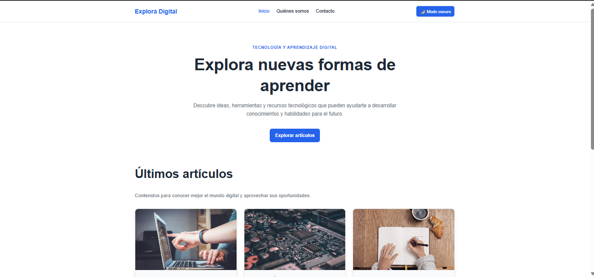

# Explora Digital

Blog de tecnología y aprendizaje digital, desarrollado como proyecto individual en el bootcamp Generation México (laboratorio AD-07: *El sitio del blog*). El sitio tiene tres páginas conectadas, un menú fijo y modo claro/oscuro.

🔗 **Demo:** https://jesusperalta0.github.io/AD-07-1-El-sitio-del-Blog/



## Páginas

| Página | Archivo | Contenido |
| --- | --- | --- |
| Inicio | `index.html` | Portada, tres artículos con imagen y sección de aprendizaje continuo |
| Quiénes somos | `about.html` | Propósito, visión y valores del proyecto |
| Contacto | `contact.html` | Datos de contacto de ejemplo |

## Características

- Tres páginas enlazadas con el mismo menú de navegación, siempre visible al hacer scroll.
- Pie de página igual en todas las páginas, con autor, correo de ejemplo y nombre del proyecto.
- Modo claro y modo oscuro. La preferencia se guarda en el navegador (`localStorage`) y se aplica en todas las páginas.
- Diseño responsive: las tarjetas pasan de 3 columnas a 2 y a 1 según el tamaño de pantalla.
- Una sola hoja de estilos (`style.css`) con variables CSS para los colores de cada tema.
- Accesibilidad: etiquetas `aria`, indicador de página actual, foco visible y respeto a la preferencia de reducir animaciones.

## Tecnologías

- HTML5
- CSS3 (variables, Grid, Flexbox, media queries)
- JavaScript (cambio de tema y `localStorage`)
- Git y GitHub Pages

## Cómo ejecutarlo

No necesita instalación. Clona el repositorio y abre `index.html` en tu navegador:

```bash
git clone https://github.com/JesusPeralta0/AD-07-1-El-sitio-del-Blog.git
cd AD-07-1-El-sitio-del-Blog
```

## Estructura

```
AD-07-1-El-sitio-del-Blog/
├── index.html
├── about.html
├── contact.html
├── style.css
├── script.js
├── img/
│   └── captura.png
├── docs/
│   ├── instructions.md
│   ├── lessonplan.md
│   └── instrucciones-participantes.docx
├── README.md
└── .gitignore
```

## Notas

- Los datos de contacto (correo y teléfono) son ficticios y se usan solo para esta actividad académica.
- Las imágenes de los artículos son de [Unsplash](https://unsplash.com) y se cargan desde internet, por lo que el sitio necesita conexión para mostrarlas.

## Autor

**Jesus Antonio Alvarez Peralta**
[GitHub](https://github.com/JesusPeralta0) · [LinkedIn](https://www.linkedin.com/in/jesus-alvarez-peralta)